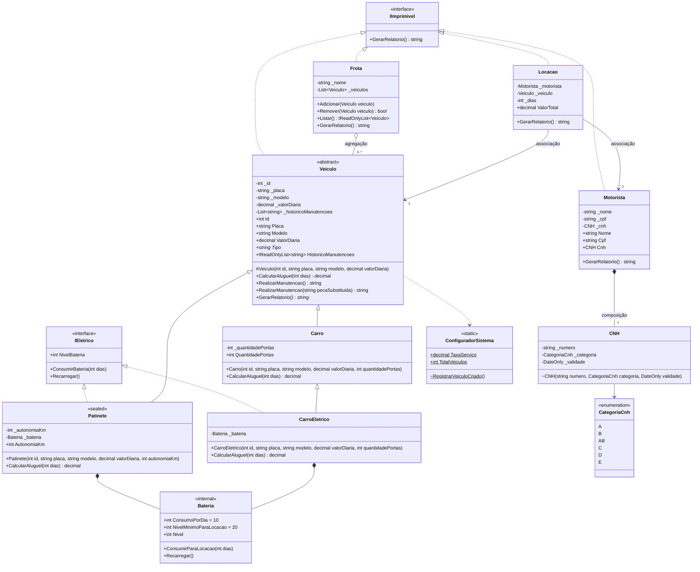
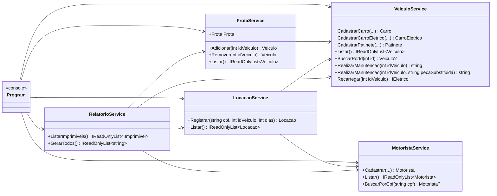

# Diagrama de classes final

Estado do código na entrega final (Sprint 4). Membros com `-` são privados, com `+` são públicos, com `#` são protegidos e com `~` são `internal`. Membros sublinhados (`$`) são estáticos. Métodos em itálico (`*`) são `virtual` ou `abstract`.

## Modelos

## Serviços e aplicação

## Onde cada conceito de POO aparece

- **Encapsulamento:** todos os campos são privados, com propriedades públicas que validam no `set` (`Placa`, `ValorDiaria`, `Nome`) ou só têm `get` (`Id`, `Cpf`, `Cnh`).
- **Composição:** `Motorista` cria e possui a `CNH` (construtor `internal`); `Patinete` e `CarroEletrico` possuem uma `Bateria`.
- **Agregação:** `Frota` guarda referências a veículos que existem por conta própria.
- **Associação:** `Locacao` usa um `Motorista` e um `Veiculo` sem ser dona deles.
- **Membros estáticos:** `ConfiguradorSistema` guarda a taxa e o contador compartilhados por todo o sistema.
- **Herança:** `Carro` e `Patinete` herdam de `Veiculo`; `CarroEletrico` herda de `Carro`. Os construtores usam `: base(...)`.
- **Sobrescrita e polimorfismo:** `CalcularAluguel` é `virtual` em `Veiculo` e sobrescrito em cada tipo; `Locacao` e o menu chamam o método numa referência `Veiculo`.
- **Sobrecarga:** `RealizarManutencao()` e `RealizarManutencao(string pecaSubstituida)`.
- **Classe selada:** `Patinete` é `sealed`.
- **Abstração:** `Veiculo` é `abstract`, com construtor `protected` e a propriedade abstrata `Tipo`.
- **Interfaces:** `IImprimivel` é implementada por classes sem relação de herança (`Veiculo`, `Motorista`, `Frota`, `Locacao`); `IEletrico` é implementada por `Patinete` e `CarroEletrico`, que têm bases diferentes.

## Regras de aluguel (taxa de 10%, 3 dias)

- **Carro** de R$ 150,00: 150 × 3 × 1,10 = 495,00 + seguro 20 × 3 = **R$ 555,00**
- **Carro elétrico** de R$ 150,00: 555,00 + recarga 10 × 3 = **R$ 585,00**
- **Patinete** de R$ 30,00: 30 × 3 × 1,10 = 99,00 × 0,80 = **R$ 79,20**
