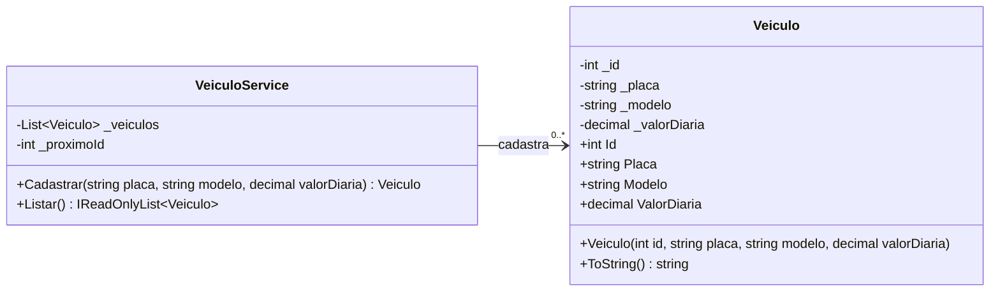

# Diagrama de classes: Sprint 1

Estado do código ao fim da Sprint 1. Membros com `-` são privados e com `+` são públicos.

## Regras de `Veiculo`

- **Id:** maior que zero. Somente leitura, definido no construtor.
- **Placa:** não pode ser nula nem vazia. É salva sem espaços e em maiúsculas.
- **Modelo:** não pode ser nulo nem vazio.
- **ValorDiaria:** maior que zero.

Qualquer valor inválido lança `ArgumentException`, tanto no construtor quanto ao alterar a propriedade depois.

## Projetos

- `UrbanDrive.Models`: `Veiculo`
- `UrbanDrive.Services`: `VeiculoService` (referencia Models)
- `UrbanDrive.App`: menu de console em `Program.cs` (referencia Models e Services)
- `UrbanDrive.Tests`: testes xUnit (referencia Models e Services)
