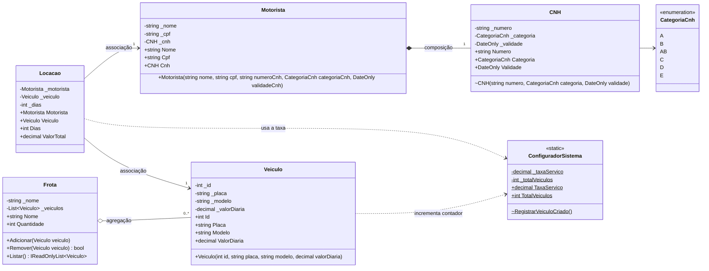
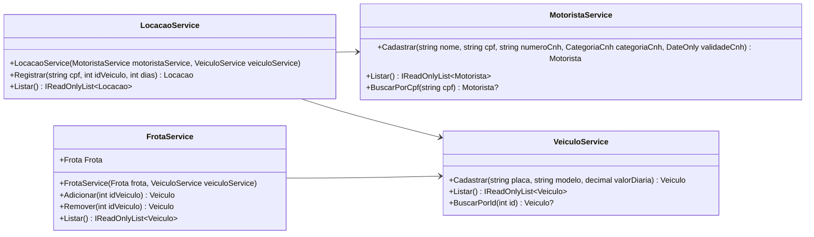

# Diagrama de classes: Sprint 2

Estado do código ao fim da Sprint 2. Membros com `-` são privados, com `+` são públicos e com `~` são `internal` (visíveis só dentro do projeto Models). Membros sublinhados (`$`) são estáticos.

## Modelos

## Serviços

## Os três relacionamentos

- **Composição (`Motorista` e `CNH`, losango preenchido):** a CNH é criada dentro do construtor do `Motorista` e o construtor da `CNH` é `internal`, então ela não existe sem o motorista e não pode ser trocada.
- **Agregação (`Frota` e `Veiculo`, losango vazio):** a frota guarda referências a veículos que existem por conta própria. Remover da frota não apaga o veículo, e o mesmo veículo pode estar em mais de uma frota.
- **Associação (`Locacao` com `Motorista` e `Veiculo`, seta):** a locação só referencia um motorista e um veículo já existentes para calcular o valor, sem ser dona deles.

## Membros estáticos

- `ConfiguradorSistema` é uma classe `static`: existe um único valor de `TaxaServico` e de `TotalVeiculos` para todo o sistema.
- O construtor de `Veiculo` chama `RegistrarVeiculoCriado()` depois das validações, e o `VeiculoService` usa `TotalVeiculos` para gerar o próximo Id.
- `Locacao.ValorTotal` lê a taxa no momento do cálculo, então alterar a taxa muda o valor das locações.
