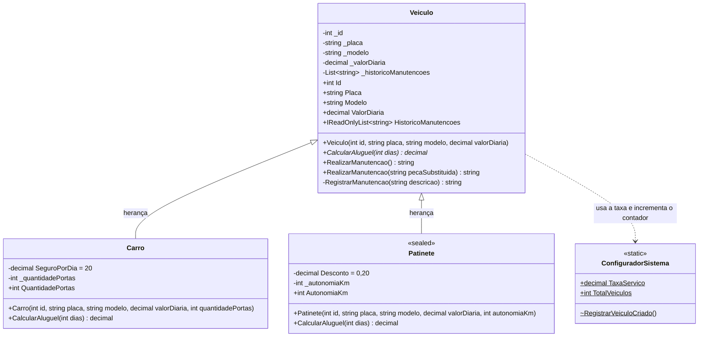
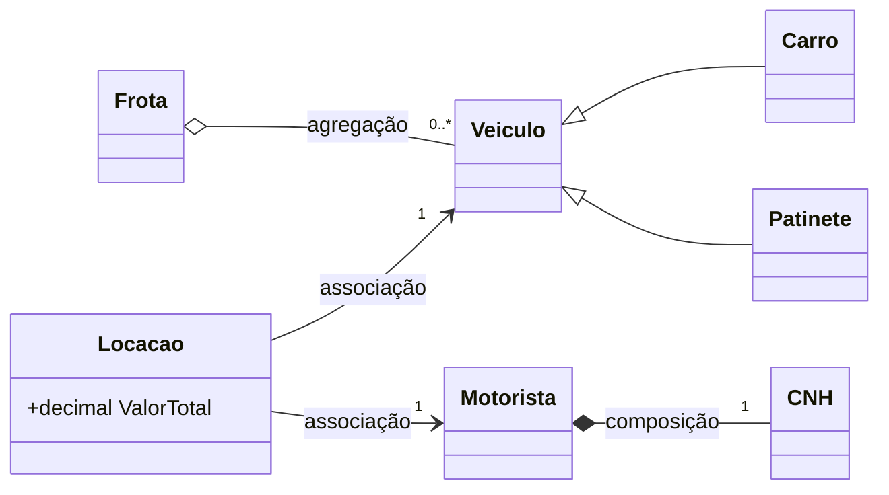

# Diagrama de classes: Sprint 3

Estado do código ao fim da Sprint 3. Membros com `-` são privados, com `+` são públicos e com `~` são `internal`. Membros sublinhados (`$`) são estáticos. Métodos em itálico (`*`) são `virtual`.

## Hierarquia de veículos

## Relacionamentos com as outras classes

`Locacao` e `Frota` continuam guardando `Veiculo`, sem saber se o objeto é um carro, um patinete ou um veículo comum.

## Como cada conceito aparece

- **Herança:** `Carro` e `Patinete` herdam Id, placa, modelo, diária, validações, contador e manutenção de `Veiculo`. Os construtores usam `: base(...)`.
- **Sobrescrita (`override`):** `CalcularAluguel` é `virtual` em `Veiculo`. `Carro` soma o seguro e `Patinete` aplica o desconto, os dois chamando `base.CalcularAluguel(dias)`.
- **Polimorfismo:** `Locacao.ValorTotal` e a opção 12 do menu chamam `CalcularAluguel` em uma referência do tipo `Veiculo`, e o C# executa a versão do tipo real do objeto.
- **Sobrecarga:** `RealizarManutencao()` e `RealizarManutencao(string pecaSubstituida)` têm o mesmo nome e parâmetros diferentes.
- **Classe selada:** `Patinete` é `sealed`, então nenhuma classe pode herdar dele.

## Regras de aluguel (taxa de 10%)

- **Veículo comum:** 150 × 3 × 1,10 = R$ 495,00
- **Carro:** 495,00 + 20 × 3 = R$ 555,00
- **Patinete:** 30 × 3 × 1,10 = 99,00 × 0,80 = R$ 79,20
